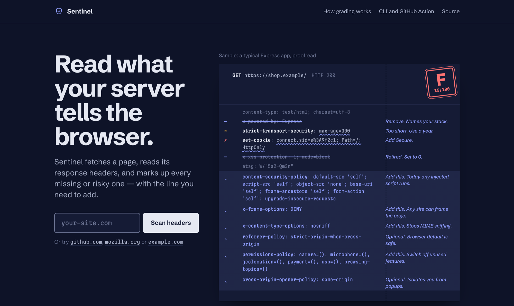
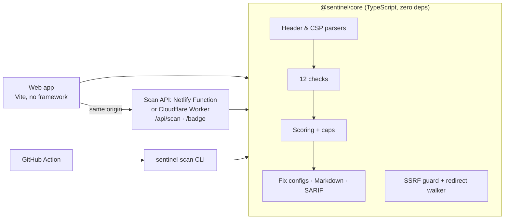

# Sentinel

**Read what your server tells the browser.** Sentinel fetches a page, grades its HTTP security headers the way a security reviewer would, and writes out the config lines that fix what's missing.

One analysis engine, four ways to run it: a web app, an edge API, a CLI, and a GitHub Action that fails the build when headers regress.

[](https://github.com/Wizminar/Sentinel/actions/workflows/ci.yml)


**Live:** https://sentinel.mohitupawar.com (domain being reconfigured; see status below)



## Project status

v2 is a full rebuild. The code is complete and tested locally. Some parts aren't deployed or published yet:

| Part | Status |
|---|---|
| Analysis engine (`packages/core`) | ✅ Working. 99 tests pass |
| Web app | ✅ Working locally. The live site still runs v1 until this branch is merged and Netlify redeploys |
| Scan API and badges | 🟡 Tested locally as a Netlify Function and as a Cloudflare Worker. Not deployed yet |
| CLI (`sentinel-scan`) | 🟡 Works from this repo (`node packages/cli/dist/cli.js`). **Not on npm yet**, so `npx sentinel-scan` doesn't work |
| GitHub Action | 🟡 Entry point tested locally. Needs a `v2` release tag before `uses: Wizminar/Sentinel@v2` resolves |
| Custom domain | 🔴 DNS record being fixed. Until then, use the [Netlify URL](https://shiny-praline-e8686d.netlify.app) |

Until the CLI is published, run it from a clone:

```bash
npm install && npm run build
node packages/cli/dist/cli.js https://your-site.com --fail-under B
```

## What it checks

Twelve checks, each parsing the header the way a browser does rather than pattern-matching strings:

| Check | What Sentinel actually evaluates |
|---|---|
| **Content-Security-Policy** | Full CSP Level 3 parser: directive fallback (`script-src` → `default-src`), multiple policies (the strictest wins), `'unsafe-inline'` neutralised by nonces/hashes, `'strict-dynamic'` ignoring allowlists, wildcard and scheme sources, known JSONP/CDN bypass hosts, `object-src`, `base-uri`, typos, Report-Only |
| **Strict-Transport-Security** | `max-age` thresholds, `max-age=0`, invalid syntax, `includeSubDomains`, preload-list eligibility |
| **Frame protection** | CSP `frame-ancestors` (preferred) and `X-Frame-Options`, including obsolete `ALLOW-FROM` |
| **Cookies** | Every `Set-Cookie` separately: `Secure`, `HttpOnly` on session-like names, `SameSite=None` without `Secure`, `__Host-`/`__Secure-` prefix rules |
| **CORS** | Sends a probe `Origin` and detects servers that **reflect arbitrary origins** with credentials; `null` origin; wildcard misuse |
| **HTTPS and redirects** | Plain HTTP, HTTPS→HTTP downgrades anywhere in the redirect chain, first redirect changing host |
| **Referrer-Policy** | Uses the last valid token like browsers do; flags `unsafe-url` |
| **Permissions-Policy** | Structured-header parsing; powerful features (camera, mic, geolocation…) open to `*`; deprecated `Feature-Policy` |
| **Cross-origin isolation** | COOP / COEP / CORP |
| **X-Content-Type-Options**, **information disclosure** (`Server` versions, `X-Powered-By`…), **deprecated headers** (`X-XSS-Protection`, HPKP, Expect-CT) | |

### Grading

Scoring follows Mozilla Observatory's model. Sites start at 100. Each check removes points up to a floor, so one header can't sink the grade by itself. Bonuses (nonce-based CSP, HSTS preload, COOP) **only count once a site already scores 90+**, so polish can't hide a missing defence. Hard caps override the arithmetic: plain HTTP can't score above D, and CORS credential reflection is an automatic F.

The point table on the site is generated from the engine's own `METHOD` export, and a test keeps it in sync with the real check floors.

## Architecture



```
packages/core     analysis engine: parsers, checks, scoring, remediation, SARIF, SSRF guard
packages/cli      sentinel-scan CLI and the GitHub Action entry (bundled to action/index.mjs)
apps/worker       scan API and badges (runs as a Cloudflare Worker or a Netlify Function)
netlify/          Netlify Function wrapper for the same API
apps/web          the site
```

### Security of the scanner itself

A URL scanner is a server-side request forger by design, so the fetch path is defended:

- **SSRF guard.** Private, loopback, link-local (cloud metadata at `169.254.169.254`), CGNAT, IPv6 ULA and IPv4-mapped addresses are refused, including numeric tricks like `http://2130706433/` and `0x7f.1`, which WHATWG URL parsing normalises before the check.
- **Redirects are followed by hand.** Every `Location` is re-validated, so a public site can't 302 the scanner into an internal network. Hops are capped and loops stop.
- **The CLI also resolves DNS** and refuses names that point at private IPs (pass `--allow-private` for your own dev servers).
- **Rate limiting** (20 scans/min per IP) and a 10-minute shared result cache protect both the API and the sites being scanned.
- **The API and site send strict headers of their own** (`apps/web/public/_headers`). Scanned locally, every check passes except HTTPS, which dev servers skip.

## Use it

### Web

Paste a URL. Reports are shareable (`/?url=github.com`), exportable as JSON, Markdown or SARIF, and include a ready-to-paste config for nginx, Apache, Caddy, Express, Vercel, Netlify or Cloudflare Pages.

### CLI

```bash
npx sentinel-scan https://your-site.com --fail-under B
npx sentinel-scan your-site.com --fix nginx          # print the lines that fix it
npx sentinel-scan a.com b.com -f sarif -o out.sarif  # multiple targets, SARIF output
curl -sI https://your-site.com | npx sentinel-scan --stdin
```

Exit codes: `0` ok, `1` below `--fail-under`, `2` scan error. Inside GitHub Actions it also writes a job summary and inline `::error` annotations.

### GitHub Action

```yaml
- uses: Wizminar/Sentinel@v2
  with:
    urls: https://preview-${{ github.event.number }}.your-site.com
    fail-under: B
    sarif-file: sentinel.sarif
- uses: github/codeql-action/upload-sarif@v3
  if: always()
  with:
    sarif_file: sentinel.sarif
```

Outputs: `grade`, `score`, `report` (JSON).

### Badge

```markdown
[](https://sentinel.mohitupawar.com/?url=your-site.com)
```

### API

```
GET /api/scan?url=example.com
→ { report: { grade, score, checks: [...] }, response: { status, headers, redirects, timingMs }, cached }
```

## Develop

```bash
npm install
npm test               # 99 tests: parsers, checks, scoring, SSRF, worker, Netlify function, CLI
npm run typecheck
npm run dev            # web app on :5173 (proxies /api to the worker)
npm run dev:worker     # worker + built site on :8787
```

### Deploy

**Netlify (simplest):** connect the repo in Netlify and deploy. `netlify.toml` already sets everything up:

- builds the site from `apps/web` and publishes `apps/web/dist`
- runs the scan API and badges as a Netlify Function (`netlify/functions/api.ts`) on the same domain, with Netlify's built-in rate limit of 20 scans/min per IP
- applies the site's security headers from `apps/web/public/_headers`

No environment variables are needed. The root `index.html` is generated from `apps/web/index.html`. Edit the source there, not the root copy.

**Cloudflare instead:** `npm run deploy:worker` deploys one Worker that serves both the site and the API.

**Manual upload (Netlify Drop):** the built site is committed at the top of this repo: `index.html`, `assets/`, `_headers`, `favicon.svg` and the logos. Drag those onto [app.netlify.com/drop](https://app.netlify.com/drop), or the whole folder. After changing the source in `apps/web`, run `npm run build`, which rebuilds and refreshes the root copy. That gives you the site without the API: scans fall back to a free public header lookup, which is rate-limited.

## What a header scan can't see

One URL with one unauthenticated GET request. It doesn't read CSPs in `<meta>` tags, doesn't look at TLS or DNS, and a perfect CSP doesn't remove an XSS bug, it only makes it harder to exploit. Headers are one layer.

## License

MIT
